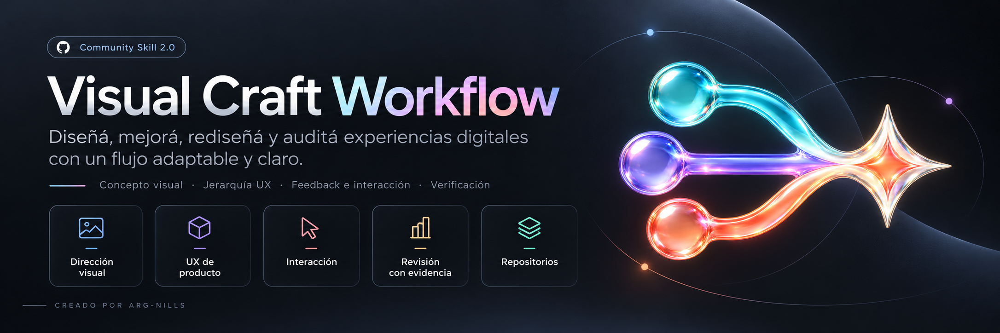
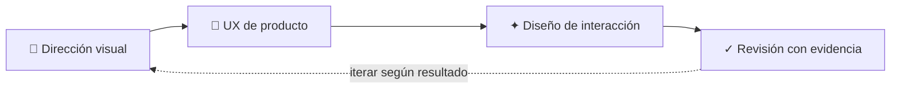

<p align="center"></p>

<p align="center">
  <a href="https://agentskills.io/specification"></a>
  <a href="#-flujo-adaptable"></a>
  <a href="#-compatibilidad"></a>
  <a href="LICENSE"></a>
</p>

<h1 align="center">Visual Craft Workflow</h1>

<p align="center"><strong>Una skill adaptable para crear y mejorar experiencias digitales con intención visual y evidencia.</strong></p>
<p align="center">Creada y refinada por <strong>ARG-NILLS</strong></p>
<p align="center">🎨 Dirección visual · 🧭 UX de producto · ✦ Interacción · ✓ Revisión</p>
<p align="center"><code>visual-craft-workflow</code> · Formato Agent Skills · Instrucciones y documentación en español</p>

<p align="center"><a href="#-qué-resuelve">Qué resuelve</a> · <a href="#-flujo-adaptable">Flujo</a> · <a href="#-instalación">Instalación</a> · <a href="#-compatibilidad">Compatibilidad</a></p>

> Una sola entrada. Un flujo adaptable al alcance real del trabajo.

## ✦ Qué resuelve

Guía a agentes de IA al diseñar, rediseñar, refinar, planificar o auditar sitios, apps, interfaces y otros proyectos visuales. Conserva la marca, las tecnologías, el contenido y las restricciones del proyecto.

La skill elige solo las etapas útiles. Una auditoría sigue siendo de solo lectura; una mejora pequeña conserva la dirección existente; un rediseño amplio puede usar el flujo completo.

Antes de diseñar, concretá la tarea principal, la plataforma, la identidad que debe conservarse y cómo se reconocerá un buen resultado. En proyectos nuevos, proponé un sistema visual acorde al producto; en proyectos existentes, heredalo y extendelo. En trabajos amplios, guardá decisiones por etapas en la documentación del proyecto solo cuando aporten continuidad.

## 🧭 Flujo adaptable



### Capacidades integradas

| Etapa | Aporta |
| --- | --- |
| **Dirección visual y sistema** | Concepto, patrones según plataforma y tecnologías, tokens de diseño, composición, tipografía, color e imágenes; se define cuando el alcance lo justifica. |
| **Experiencia de producto** | Tareas, jerarquía, recorridos, estados, descubrimiento y comprobaciones de usabilidad pertinentes. |
| **Diseño de interacción** | Teclado, tacto, movimiento, respuesta visual y acabado. |
| **Revisión con evidencia** | Comprobaciones y hallazgos priorizados según impacto y evidencia. |

Activá solo las etapas que mejoran el resultado. Descubrimiento, tipografía, heurísticas, microinteracciones, conversión y rendimiento se consultan cuando responden a una necesidad concreta. El flujo funciona sin herramientas ni especialidades complementarias.

## 🔀 Enrutamiento

| Solicitud | Enfoque |
| --- | --- |
| Superficie nueva o rediseño amplio | Concepto, experiencia, implementación y revisión. |
| Pantalla de una app | Tareas, estados, legibilidad, accesibilidad e interacción. |
| Ajuste puntual | Mantener la identidad; cambiar solo lo pedido. |
| Auditoría o crítica | Revisar la evidencia disponible; no editar. |
| Movimiento | Claridad, duración, frecuencia, rendimiento y movimiento reducido. |
| Repositorio en preparación o mejora | Revisar identidad, descripción, README, estructura y presentación. |
| Trabajo no visual | Omitir el flujo visual. |

## 📂 Estructura

```text
visual-craft-workflow/
├── assets/
│   └── visual-craft-workflow-banner.png
├── CHANGELOG.md
├── README.md
├── references/
│   └── liquid-glass-style.md
└── SKILL.md
```

El nombre del repositorio, la carpeta de la skill y el campo name del manifiesto usan visual-craft-workflow.

El banner reúne el nombre, el emblema de vidrio líquido y las capacidades del flujo en una sola imagen. La referencia Liquid Glass se carga solo cuando la dirección visual la pide; no se impone a otros proyectos.

## 📥 Instalación

El repositorio es público y se puede clonar sin autenticarte. No guardes tokens en comandos ni archivos.

### Codex

En PowerShell:

```powershell
New-Item -ItemType Directory -Force "$env:USERPROFILE\.agents\skills" | Out-Null
git clone https://github.com/ARG-NILLS/visual-craft-workflow.git "$env:USERPROFILE\.agents\skills\visual-craft-workflow"
```

Recargá Codex si la skill no aparece.

### Gemini CLI

```powershell
gemini skills install https://github.com/ARG-NILLS/visual-craft-workflow
```

En una sesión interactiva, confirmá que aparezca con /skills list.

### MiniMax Code

Desde la raíz del proyecto:

```powershell
New-Item -ItemType Directory -Force ".minimax\skills" | Out-Null
git clone https://github.com/ARG-NILLS/visual-craft-workflow.git ".minimax\skills\visual-craft-workflow"
```

Volvé a abrir la sesión para cargar cambios.

### Otros agentes

Instalá la carpeta en una ruta que el host descubra. Si no carga Agent Skills, compartí SKILL.md o sus instrucciones. Un formato portable no activa la skill automáticamente en cada producto.

## 🧩 Compatibilidad

| Host | Compatibilidad documentada | Límite conocido |
| --- | --- | --- |
| [Codex](https://developers.openai.com/plugins/concepts/skills) | Usa carpetas con un manifiesto SKILL.md y las instrucciones asociadas. | La ruta de instalación depende del perfil y del entorno. |
| [Gemini CLI](https://geminicli.com/docs/cli/using-agent-skills/) | Permite instalar desde un repositorio y listar skills disponibles. | Esto no implica soporte automático en Gemini web. |
| [MiniMax Code](https://github.com/MiniMax-AI/minimax-code/blob/main/docs/tui-capabilities.md#skill-directory-links) | Documenta raíces de skills del proyecto en .agents/skills y .minimax/skills. | La disponibilidad depende de la configuración y de la sesión. |
| Otros agentes | Puede usarse si el host lee el formato o el archivo. | Invocación, herramientas y permisos dependen del host. |

La tabla resume documentación oficial consultada; no afirma que cada entorno se haya probado en ejecución.

## 💬 Ejemplos

- “Usá visual-craft-workflow para rediseñar esta página de inicio. Conservá la marca y las tecnologías.”
- “Auditá diseño adaptable, navegación y teclado. Informá hallazgos; no edites.”
- “Mejorá este modal sin cambiar la dirección visual.”
- “Definí el sistema visual de esta app según su plataforma y tarea principal. Conservá la identidad que ya existe.”
- “Prepará este repositorio: revisá nombre, descripción, README y consistencia.”

## 👤 Autoría y cambios

Creado y mejorado por **ARG-NILLS**. La arquitectura del flujo, sus criterios de adaptación, la documentación y la identidad visual pertenecen a este proyecto. El repositorio presenta sus capacidades sin enumerar skills, autores ni repositorios externos.

Revisá [CHANGELOG.md](CHANGELOG.md) para ver su evolución.

## ⚖️ Licencia

Este proyecto se distribuye bajo la licencia [MIT](LICENSE). Al redistribuir copias o partes sustanciales, conservá el aviso de derechos de autor y el texto de permiso incluidos en LICENSE.
