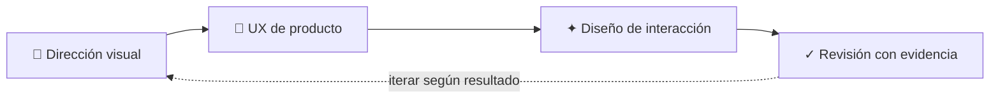

<p align="center"></p>

<p align="center">
  <a href="https://agentskills.io/specification"></a>
  <a href="#-pipeline-adaptable"></a>
  <a href="#-compatibilidad"></a>
  <a href="LICENSE"></a>
</p>

<h1 align="center">Visual Craft Workflow</h1>

<p align="center"><strong>Una skill adaptable para crear y mejorar experiencias digitales con intención visual y evidencia.</strong></p>
<p align="center">Creada y refinada por <strong>ARG-NILLS</strong></p>
<p align="center">🎨 Dirección visual · 🧭 UX de producto · ✦ Interacción · ✓ Revisión</p>
<p align="center"><code>visual-craft-workflow</code> · Agent Skill · Núcleo en inglés, documentación en español</p>

<p align="center"><a href="#-qué-resuelve">Qué resuelve</a> · <a href="#-pipeline-adaptable">Pipeline</a> · <a href="#-instalación">Instalación</a> · <a href="#-compatibilidad">Compatibilidad</a></p>

> Una sola entrada. Un flujo adaptable al alcance real del trabajo.

## ✦ Qué resuelve

Guía a agentes de IA al diseñar, rediseñar, refinar, planificar o auditar sitios, apps, interfaces y otros proyectos visuales. Conserva la marca, el stack, el contenido y las restricciones del proyecto.

La skill elige solo las etapas útiles. Una auditoría sigue siendo de solo lectura; una mejora pequeña conserva la dirección existente; un rediseño amplio puede usar el flujo completo.

## 🧭 Pipeline adaptable



### Capacidades integradas

| Etapa | Aporta |
| --- | --- |
| **Dirección visual** | Concepto, composición, tipografía, color e imágenes relevantes. |
| **UX de producto** | Objetivos, jerarquía, flujos, estados y usabilidad. |
| **Diseño de interacción** | Teclado, tacto, movimiento, feedback y acabado. |
| **Revisión con evidencia** | Comprobaciones acordes al alcance y al resultado esperado. |

Activa solo las etapas que mejoran el resultado; amplía el flujo cuando el trabajo lo exige.

## 🔀 Enrutamiento

| Solicitud | Enfoque |
| --- | --- |
| Nueva superficie o rediseño amplio | Concepto, UX, implementación y revisión. |
| Pantalla de producto | Tareas, estados, legibilidad, accesibilidad e interacción. |
| Ajuste puntual | Mantener la identidad; cambiar solo lo pedido. |
| Auditoría o crítica | Revisar evidencia disponible; no editar. |
| Motion | Claridad, duración, frecuencia, rendimiento y movimiento reducido. |
| Repositorio en preparación o pulido | Revisar identidad, descripción, README, estructura y presentación. |
| Trabajo no visual | Omitir la pipeline visual. |

## 📂 Estructura

```text
visual-craft-workflow/
├── assets/
│   └── visual-craft-workflow-banner.png
├── CHANGELOG.md
├── README.md
├── references/
│   └── liquid-glass-style.md
└── SKILL.md
```

El slug del repositorio, la carpeta de la skill y `name` en el frontmatter usan `visual-craft-workflow`.

El banner reúne el nombre, el emblema de vidrio líquido y las capacidades del flujo en una sola imagen. La referencia Liquid Glass se carga solo cuando la dirección visual la pide; no se impone a otros proyectos.

## 📥 Instalación

Si el repositorio aún es privado, inicia sesión en GitHub y confirma permiso de lectura. Una vez público, podrás clonarlo sin autenticarte. No guardes tokens en comandos ni archivos.

### Codex

En PowerShell:

```powershell
New-Item -ItemType Directory -Force "$env:USERPROFILE\.agents\skills" | Out-Null
git clone https://github.com/ARG-NILLS/visual-craft-workflow.git "$env:USERPROFILE\.agents\skills\visual-craft-workflow"
```

Recarga Codex si la skill no aparece.

### Gemini CLI

```powershell
gemini skills install https://github.com/ARG-NILLS/visual-craft-workflow
```

Confirma que figure en `/skills list`.

### MiniMax Code

Desde la raíz del proyecto:

```powershell
New-Item -ItemType Directory -Force ".minimax\skills" | Out-Null
git clone https://github.com/ARG-NILLS/visual-craft-workflow.git ".minimax\skills\visual-craft-workflow"
```

Vuelve a abrir la sesión para cargar cambios.

### Otros agentes

Instala la carpeta en una ruta que el host descubra. Si no carga Agent Skills, comparte `SKILL.md` o sus instrucciones. Un formato portable no habilita la skill automáticamente en cada producto.

## 🧩 Compatibilidad

| Host | Compatibilidad documentada | Límite conocido |
| --- | --- | --- |
| Codex | Usa skills con `SKILL.md`. | La ruta depende del sistema y perfil. |
| Gemini CLI | Descubre Agent Skills y admite instalación desde repositorios. | Esto no implica soporte automático en Gemini web. |
| MiniMax Code | Documenta `.agents/skills` y `.minimax/skills`. | Esto no implica soporte automático en MiniMax web o chat. |
| Otros agentes | Puede usarse si el host lee el formato o el archivo. | Invocación, herramientas y permisos dependen del host. |

Compatibilidad descrita según documentación del host; no afirma que cada entorno se haya probado en ejecución.

## 💬 Ejemplos

- “Usa `visual-craft-workflow` para rediseñar esta landing. Conserva marca y stack.”
- “Audita responsive, navegación y teclado. Informa hallazgos; no edites.”
- “Mejora este modal sin cambiar la dirección visual.”
- “Prepara este repositorio: revisa nombre, descripción, README y consistencia.”

## 👤 Autoría y cambios

Creado y mejorado por **ARG-NILLS**. La arquitectura del pipeline, sus criterios de adaptación, la documentación y la identidad visual pertenecen a este proyecto.

Revisa [CHANGELOG.md](CHANGELOG.md) para ver su evolución.

## ⚖️ Licencia

Este proyecto se distribuye bajo la licencia [MIT](LICENSE). Conserva el aviso de autoría de ARG-NILLS al reutilizarlo.

