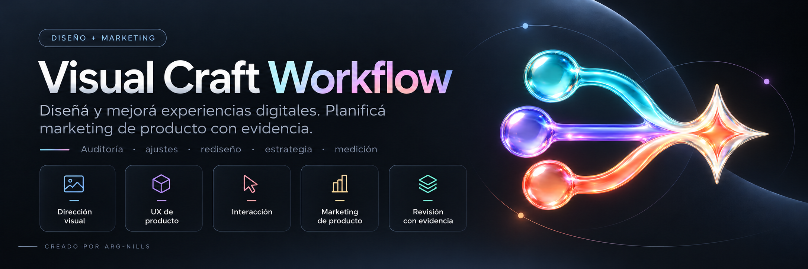
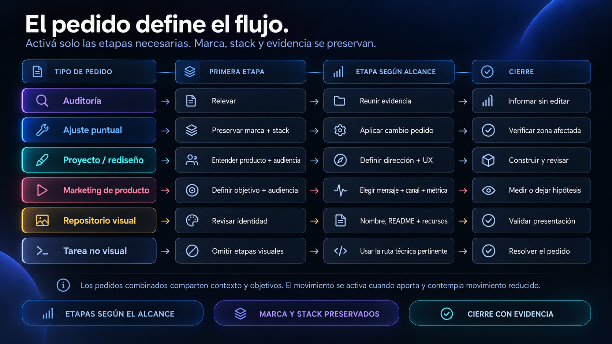

  
  
  
  
  

<h1 align="center">Visual Craft Workflow</h1>

<strong>Una skill adaptable para mejorar experiencias digitales y marketing de producto con intención y evidencia.</strong>

Creada y refinada por <strong>ARG-NILLS</strong>

🎨 Dirección visual · 🧭 UX de producto · ✦ Interacción · 📣 Marketing · ✓ Revisión

visual-craft-workflow · Formato Agent Skills · Instrucciones y documentación en español

<a href="#-qué-resuelve">Qué resuelve</a> · <a href="#-flujo-adaptable">Flujo</a> · <a href="#-marketing">Marketing</a> · <a href="#-instalación">Instalación</a> · <a href="#-compatibilidad">Compatibilidad</a>

> Una sola entrada. Etapas ajustadas al alcance, con marca, contexto y evidencia compartidos.

## ✦ Qué resuelve

Guía a agentes de IA para diseñar, rediseñar, refinar, planificar o auditar sitios, apps, interfaces y otros proyectos visuales. También ayuda con estrategia y ejecución de marketing para productos digitales.

Conserva la marca, las tecnologías, el contenido y las restricciones del proyecto. Una auditoría es de solo lectura; un ajuste puntual mantiene la dirección existente; un rediseño amplio puede recorrer más etapas. El trabajo comercial se activa según el objetivo y la evidencia disponible.

## 🧭 Flujo adaptable

### Mapa actualizado

### Ejemplo animado

https://github.com/user-attachments/assets/e823339a-4e51-4de6-907c-e5fcdba8dce3

Descargá el video: <a href="assets/Visual-Craft-Workflow-ejemplo.webm">Visual-Craft-Workflow-ejemplo.webm</a> · 16,5 s.

El video muestra un recorrido animado; el diagrama superior presenta las rutas actuales.

### Capacidades

| Etapa | Aporta |
| --- | --- |
| **Dirección visual** | Concepto, composición, tipografía, color, imágenes y materiales propios del producto. |
| **Experiencia de producto** | Tareas, jerarquía, recorridos, estados y comprobaciones de usabilidad pertinentes. |
| **Interacción** | Controles, teclado, tacto, movimiento, respuesta visual y adaptación. |
| **Marketing de producto** | Estrategia, contenido, adquisición, conversión, retención y medición según el objetivo. |
| **Revisión con evidencia** | Comprobaciones y hallazgos priorizados; observaciones separadas de supuestos. |

Activá solo las etapas que mejoran el resultado. El flujo funciona sin herramientas complementarias; las integraciones son opcionales.

## 🔀 Enrutamiento

| Solicitud | Enfoque |
| --- | --- |
| Auditoría o crítica | Revisar evidencia, informar límites y no editar. |
| Ajuste puntual | Mantener identidad y tocar solo el área pedida. |
| Proyecto nuevo o rediseño | Comprender producto, definir dirección y validar experiencia. |
| Movimiento o efecto visual | Revisar propósito, accesibilidad, adaptación y costo. |
| Marketing de producto digital | Activar los grupos comerciales necesarios. |
| Repositorio visual | Elegir diagramas, capturas directas o demos según el proyecto. Revisar el README renderizado y acompañar cada versión final con notas de release. |
| Trabajo combinado | Compartir contexto y objetivo entre diseño y marketing. |
| Pedido no visual ni comercial | Omitir este flujo. |

## 📣 Marketing

| Grupo | Ejemplos de trabajo | Entrega esperada |
| --- | --- | --- |
| **Estrategia** | Audiencia, alternativas, posicionamiento, oferta, precios y lanzamiento. | Decisiones y prioridades con supuestos visibles. |
| **Contenido** | Voz, mensajes, páginas, textos, piezas, video y calendario. | Contenidos ajustados a audiencia, canal y hechos confirmados. |
| **Adquisición** | SEO, búsqueda con IA, anuncios, redes, alianzas, comunidad, prensa y eventos. | Canales elegidos según objetivo, recursos y evidencia. |
| **Conversión y activación** | Páginas, formularios, registro, onboarding y planes. | Recorrido claro, acción real y medición pertinente. |
| **Retención y recomendación** | Mensajes, recuperación, cancelación, referidos y expansión. | Experimentos o recorridos con consentimiento y objetivo claro. |
| **Operación y medición** | Analítica, atribución, UTMs para campañas externas, experimentos y coordinación comercial. | Convención de nombres, enlaces verificados, métricas y datos faltantes. |

Cada recomendación vincula objetivo, acción, recurso, métrica y evidencia faltante. El impacto esperado sigue siendo hipótesis hasta medirse. No se envían campañas ni se gasta presupuesto sin autorización explícita.

### Ejemplo de campaña con UTM

Querés distinguir las visitas de una newsletter que anuncia una demo. Para un enlace externo, el resultado ilustrativo es `https://example.com/demo?utm_source=newsletter&utm_medium=email&utm_campaign=demo-producto`.

| Fuente | Canal | Campaña | Qué comprobar |
| --- | --- | --- | --- |
| `newsletter` | `email` | `demo-producto` | Abrí el enlace, seguí las redirecciones y comprobá en tu analítica los valores recibidos. |

## 📂 Estructura

    visual-craft-workflow/
    ├── assets/
    │   ├── backup/
    │   │   └── visual-craft-workflow-banner-anterior.png
    │   ├── flujo-de-pedido-en-cuatro-etapas.png
    │   ├── Visual-Craft-Workflow-ejemplo.webm
    │   └── visual-craft-workflow-banner.png
    ├── references/
    │   ├── liquid-glass-style.md
    │   ├── marketing-workflow.md
    │   ├── motion.md
    │   ├── quality-review.md
    │   ├── ui-tooling.md
    │   └── visual-direction.md
    ├── CHANGELOG.md
    ├── LICENSE
    ├── README.md
    └── SKILL.md

El nombre del repositorio, la carpeta de la skill y el campo name del manifiesto usan visual-craft-workflow. La portada, el ejemplo en video y los recursos existentes se conservan como parte del repositorio.

## 📥 Instalación

El repositorio es público y se puede clonar sin autenticarte. No guardes tokens en comandos ni archivos.

### Codex

En PowerShell:

    New-Item -ItemType Directory -Force "$env:USERPROFILE\.agents\skills" | Out-Null
    git clone https://github.com/ARG-NILLS/visual-craft-workflow.git "$env:USERPROFILE\.agents\skills\visual-craft-workflow"

Recargá Codex si la skill no aparece.

### Gemini CLI

    gemini skills install https://github.com/ARG-NILLS/visual-craft-workflow

En una sesión interactiva, confirmá que aparezca con /skills list.

### MiniMax Code

Desde la raíz del proyecto:

    New-Item -ItemType Directory -Force ".minimax\skills" | Out-Null
    git clone https://github.com/ARG-NILLS/visual-craft-workflow.git ".minimax\skills\visual-craft-workflow"

Volvé a abrir la sesión para cargar cambios.

### Otros agentes

Instalá la carpeta en una ruta que el host descubra. Si el agente no carga Agent Skills, compartí SKILL.md y las referencias necesarias. El formato portable no activa la skill automáticamente en cada producto.

## 🧩 Compatibilidad

| Host | Compatibilidad documentada | Límite conocido |
| --- | --- | --- |
| [Codex](https://developers.openai.com/plugins/concepts/skills) | Lee carpetas de skills con un manifiesto SKILL.md y sus instrucciones asociadas. | La ruta depende del perfil y el entorno. |
| [Gemini CLI](https://geminicli.com/docs/cli/skills/) | Permite instalar skills desde un repositorio y listar las disponibles. | No implica soporte automático en Gemini web. |
| [MiniMax Code](https://github.com/MiniMax-AI/minimax-code/blob/main/docs/tui-capabilities.md#skill-directory-links) | Documenta raíces de skills de proyecto, incluidos .agents/skills y .minimax/skills. | La disponibilidad depende de la configuración y sesión. |
| Otros agentes | Puede usarse si el host lee este formato o el archivo. | Invocación, herramientas y permisos dependen del host. |

La tabla resume documentación consultada; no afirma que cada entorno se haya probado en ejecución.

## 💬 Ejemplos

- “Revisá la portada y el README de este repo. Comprobá que se entienda el proyecto y que funcionen los badges y enlaces.”

- “Usá visual-craft-workflow para rediseñar esta página. Conservá marca y tecnologías.”
- “Auditá navegación, adaptación y teclado. Informá hallazgos; no edites.”
- “Mejorá este modal sin cambiar la dirección visual.”
- “Armá una estrategia de lanzamiento para este producto. Separá hechos, supuestos y datos faltantes.”
- “Revisá esta campaña y proponé mejoras de copy y medición. No publiques ni la envíes.”
- “Prepará UTMs para estos enlaces de campaña. Respetá la convención existente y verificá que no se pierdan en la redirección.”
- “Analizá el onboarding y la retención con los datos disponibles. No inventes métricas.”

## 👤 Autoría y cambios

Creado y mejorado por **ARG-NILLS**. El repositorio presenta las capacidades propias del proyecto sin enumerar skills, autores ni repositorios externos.

Consultá la [última versión estable y sus notas](https://github.com/ARG-NILLS/visual-craft-workflow/releases/latest) o recorré el [historial completo](CHANGELOG.md).

## ⚖️ Licencia

Este proyecto se distribuye bajo la licencia [MIT](LICENSE). Al redistribuir copias o partes sustanciales, conservá el aviso de derechos de autor y el texto de permiso incluidos en LICENSE. Esa licencia no reemplaza las condiciones de dependencias, componentes, fuentes, fotos, videos ni otros recursos externos; revisá cada licencia y aviso por separado.
